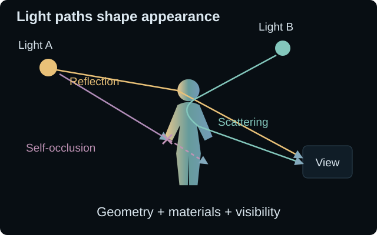
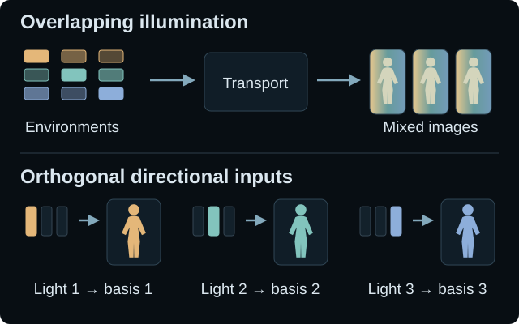
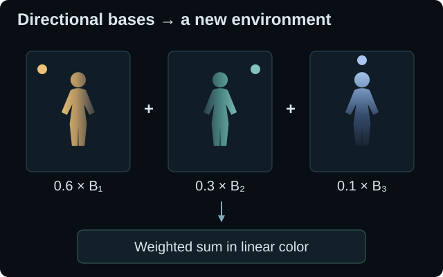
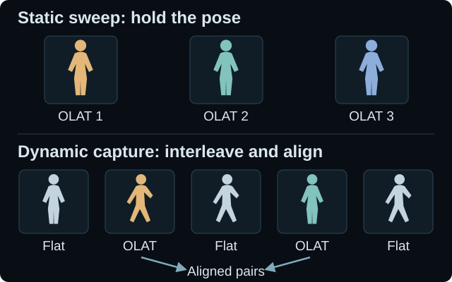

# The Insights Behind DynOLAT

## 中英文对照编辑稿

对应网页：[The Insights Behind DynOLAT](project-source.html)

同步基准：本次修订后的 `project-source.html`（2026-10-20）。

**修改方式：** 直接修改各段的「中文」内容即可；下方英文保留当前网页原文作为对照。段落编号用于将修改对应回网页。公式由中英文共用；图注、折叠说明和图内文字均已收录。

这是一份供人工修改的独立稿件。修改本文件不会自动更新网页；后续可以据此同步英文文案与 HTML。

---

## 00 / 开篇 · Opening

**中文｜页面标题**

DynOLAT 背后的思考

**English**

The Insights Behind DynOLAT

**中文｜核心问题**

如何渲染任意光照下的人体，同时保持动态下时序一致性？

**English**

How can we render a person under arbitrary lighting while preserving temporal consistency in motion?

---

## 01 / 渲染的挑战 · The rendering challenge

网页位置：`#rendering`

**中文｜01 / 章节标题**

光传输在计算过程中的理论限制

**English**

Theoretical limits of computing light transport.

**中文｜01.P01**

对于运动中的人体，基于物理的渲染器需要精确的几何，以及皮肤、毛发和衣物的材质信息。从图像恢复这些场景资产是一个约束不足的问题，而达到制作级品质通常需要大量采集、艺术家投入和计算资源。这些实际成本使其难以扩展到大量人物与表演。

**English**

For moving humans, a physical renderer needs accurate geometry and the materials of skin, hair, and clothing. Recovering these assets from images is underconstrained, and production quality often requires substantial capture, artist effort, and computation. These practical costs make scaling across people and performances difficult.

### 01.F01 / 配图

**中文｜01.F01 / 图注**

场景资产的保真度与光传输的近似精度都很重要。复杂光路可以被模拟，但其外观取决于场景模型与数值近似。

**English**

Asset fidelity and transport approximation both matter. Complex light paths can be simulated, but their appearance depends on the scene model and the numerical approximation.

**中文｜图片替代文本**

反射、散射和自遮挡取决于人物的几何与材质，并共同决定最终的渲染外观。

**English alt text**

Reflection, scattering, and self-occlusion depend on the person's geometry and materials, and all contribute to the rendered appearance.

**图内文字对照**

| 中文 | English |
| --- | --- |
| 光路塑造外观 | Light paths shape appearance |
| 光源 A | Light A |
| 光源 B | Light B |
| 视角 | View |
| 反射 | Reflection |
| 散射 | Scattering |
| 自遮挡 | Self-occlusion |
| 几何 + 材质 + 可见性 | Geometry + materials + visibility |

**中文｜01.P02**

将一般光传输压缩为有限表示，也存在理论上的限制。在论文 [A Theoretical Analysis of Compactness of the Light Transport Operator](https://homepages.inf.ed.ac.uk/ksubr/Files/Papers/SIG22_Compactness.pdf) 中，Soler、Molazem 和 Subr（2022）指出，一般光传输算子是非紧的。因此，有限秩近似无法在所有单位范数的输入辐亮度场上，一致收敛到该算子。

**English**

There is also a limit to compressing general transport into finite representations. In [A Theoretical Analysis of Compactness of the Light Transport Operator](https://homepages.inf.ed.ac.uk/ksubr/Files/Papers/SIG22_Compactness.pdf), Soler, Molazem, and Subr (2022) show that the general transport operator is non-compact. Finite-rank approximations therefore cannot converge to it uniformly over all unit-norm input radiance fields.

### 01.E01 / 公式

**中文｜01.E01 / 公式标题**

有限秩一致近似的局限

**English**

A limit on uniform finite-rank approximation

**公式（中英文共用）**

$$
\begin{gathered}
\ell = e + \mathcal{K}\ell
\\
\mathcal{K}\text{ non-compact}
\;\Rightarrow\;
\lVert\mathcal{K}-\mathcal{K}_N\rVert_{\mathrm{op}}\not\to 0
\end{gathered}
$$

**中文｜01.E01 / 公式说明**

$\ell$ 是总辐亮度场；$e$ 是光源发出的辐亮度；$\mathcal{K}\ell$ 是光经过传播并反射一次后贡献的辐亮度。通俗地说：总光 = 光源发出的光 + 反射来的光。$\mathcal{K}_N$ 是有限秩近似，算子范数衡量所有单位范数输入上的最坏情况误差。

**English**

<i>ℓ</i> is the total radiance field; <i>e</i> is emitted radiance from the light sources; 𝒦<i>ℓ</i> is radiance arriving after propagation and one reflection. In plain terms: total light = emitted light + bounced light. 𝒦N is a finite-rank approximation; the operator norm measures worst-case error over unit-norm inputs.

**中文｜01.P03**

**为什么有限表示总可能漏掉一些东西？** 可以把有限基理解为一套数量有限的“光照词汇”。一般光传输仍能保留这套词汇之外的变化。增加词汇能改善特定输入的近似，却不能让所有可能的单位范数辐亮度场上的最坏情况误差都趋近于零。数学上的原因是：有限秩算子都是紧算子，而紧算子在算子范数下的极限仍然是紧的，因此非紧算子不可能成为这样的极限。

**English**

**Why can a finite representation miss something?** Think of a finite basis as a limited vocabulary of light patterns. General transport can preserve variations that lie outside any such finite vocabulary. Enlarging it helps for particular inputs, but cannot make the worst-case error vanish over every possible unit-norm radiance field. Mathematically, finite-rank operators are compact, and their operator-norm limits remain compact; a non-compact operator cannot be such a limit.

**中文｜01.P04**

这一结论针对完整辐亮度场的一致有限秩近似；它并不否定针对具体场景的渲染方法或蒙特卡洛方法的收敛性。下文将转向一个不同的问题：在有限分辨率下，如何设计足够有信息量的监督来学习生成模型。

**English**

This concerns uniform finite-rank approximation of the full radiance field; it does not rule out scene-specific rendering methods or Monte Carlo convergence. Next we turn to a different question: at finite resolution, how can we design informative supervision for a generative model?

---

## 02 / 监督的挑战 · The supervision challenge

网页位置：`#supervision`

**中文｜02 / 章节标题**

图像逼真，并不意味着光照控制精确。

**English**

A convincing image does not yet mean precise light control.

**中文｜02.P01**

生成模型为外观与运动提供了强大的先验。以环境光照图作为条件，可以把重光照转化为生成任务：根据指定光照，预测新的图像或视频。但仍有两个问题：训练数据对是否忠实反映真实的光照变化，以及它们是否能独立约束不同光照方向的作用。

**English**

Generative models provide strong priors for appearance and motion. Environment-map conditioning turns relighting into a generation task: predict a new image or video for a requested illumination. Two questions remain: how faithfully the training pairs represent real lighting changes, and how independently they constrain different lighting directions.

**中文｜02.P02**

**Stanford / HKUST（[IC-Light](https://proceedings.iclr.cc/paper_files/paper/2025/file/1cce374fec7829c24a97ae0e91cd0999-Paper-Conference.pdf)）。** 其自然图像分支通过退化或增强输入外观，并估计目标光照来构造重光照数据对，而不是在经过标定的不同光照下重新拍摄同一场景。完整方法也使用了渲染数据与真实 Light Stage 数据，并施加光传输一致性约束。我们关注的是：即使目标照片是真实的，增强流程和估计光照所提供的监督仍然是近似的。

**English**

**Stanford / HKUST ([IC-Light](https://proceedings.iclr.cc/paper_files/paper/2025/file/1cce374fec7829c24a97ae0e91cd0999-Paper-Conference.pdf)).** Its in-the-wild branch creates relighting pairs by degrading or augmenting input appearance and estimating target lighting, rather than recapturing the same scene under calibrated lights. The full method also uses rendered and real Light Stage data, and imposes light-transport consistency. Our concern is that augmentation and estimated lighting provide approximate supervision, even when the target photograph is real.

**中文｜02.P03**

**NVIDIA / University of Toronto（[DiffusionRenderer](https://arxiv.org/abs/2501.18590)）。** 其正向渲染器以 G-buffers 和环境光照图为条件生成视频。合成数据提供精确标签，但论文指出，仅用合成数据训练会产生域差距。因此，方法进一步加入自动标注的真实视频，以及用于真实数据的 LoRA；估计出的几何、材质和光照仍可能含有误差。这促使我们重视实测数据对，但并不意味着上述方法只使用合成监督。

**English**

**NVIDIA / University of Toronto ([DiffusionRenderer](https://arxiv.org/abs/2501.18590)).** Its forward renderer conditions video generation on G-buffers and an environment map. Synthetic data provides exact labels, but the paper reports a domain gap when training on synthetic data alone. It therefore adds auto-labeled real videos and a LoRA for real data; the estimated geometry, materials, and lighting can still contain errors. This motivates measured pairs without implying that either method uses only synthetic supervision.

### 02.F01 / 配图

**中文｜02.F01 / 图注**

每个环境图对应一张生成结果。三个环境图都混合了多个光照方向；更换环境图会同时改变多个变量。这个概念示例中，人物和姿态保持一致。

**English**

One environment map, one generated result. The three maps mix multiple lighting directions; changing a map changes several variables together. The shared subject and pose are held fixed in this conceptual example.

**中文｜图片替代文本**

三个环境光照图纵向排列，每个环境图通过生成模型，得到同一姿态在不同光照下的一张对应图像。

**English alt text**

Three environment maps are arranged vertically. Each conditions generation of one corresponding image of the same pose, with a different lighting appearance.

**图内文字对照**

| 中文 | English |
| --- | --- |
| 环境光照条件下的生成 | Environment-conditioned generation |
| 环境光照图 | Environment map |
| 生成图像 | Generated image |
| 生成 | Generation |
| 相同输入 | same input |

**中文｜02.P04**

即使数据对完全准确，混合光照仍然带来一个辨识问题。把单颜色通道的 $h\times w$ 环境光照图展开为 $N=hw$ 个方向上的数值。对于固定场景，每个图像像素都有 $N$ 个待确定的方向系数；一张环境光照下的观测图像，为这些系数提供一个方程。要完整辨识不受额外约束的响应，至少需要 $N$ 个线性独立的光照配置。

**English**

Even with perfect pairs, mixed illumination leaves an identification question. Flatten an <i>h</i> × <i>w</i> environment map into <i>N</i> = <i>hw</i> directional values for one color channel. For a fixed scene, each image pixel has <i>N</i> unknown directional coefficients. One environment-lit observation supplies one equation for those coefficients. To identify an unrestricted response, we need at least <i>N</i> independent illumination configurations.

### 02.E01 / 公式

**中文｜02.E01 / 公式标题**

需要多少个独立的环境光照？

**English**

How many independent environments are enough?

**公式（中英文共用）**

$$
\begin{gathered}
N=hw,\qquad E=[e_1,\ldots,e_M]\in\mathbb{R}^{N\times M}
\\ Y=TE
\\ \operatorname{rank}(E)=N \;\Rightarrow\; M\geq N=hw
\\ \text{OLAT:}\quad M=N,\quad E=I_N
\end{gathered}
$$

**中文｜02.E01 / 公式说明**

$h,w$ 是环境图的高与宽，$M$ 是光照配置数量；$E$ 的每一列 $e_j$ 都是一张展开后的环境图。若输出图像有 $P$ 个像素，则 $T\in\mathbb{R}^{P\times N}$ 将各方向的光照映射为线性图像强度，$Y\in\mathbb{R}^{P\times M}$ 存放对应的观测图像。秩条件用于在无噪声、固定场景、单颜色通道条件下辨识任意 $T$，并不是生成模型训练集规模的普遍下界。

**English**

<i>h</i> and <i>w</i> are the environment-map dimensions; <i>M</i> is the number of illumination configurations. Each column <i>e</i>j of <i>E</i> is one map. For an image with <i>P</i> pixels, <i>T</i> ∈ ℝP×N maps directional illumination to linear image intensity, and <i>Y</i> ∈ ℝP×M contains the observed images. The rank condition identifies an arbitrary <i>T</i> in the noiseless, fixed-scene setting, per color channel. It is not a universal dataset-size requirement for a generative model.

**中文｜02.P05**

**OLAT 是最直接的完整设计。** 归一化的正交基避免了光照方向上的冗余，其条件数为 1。物理光强非负，因此正交模式的方向支撑集不能重叠。在 $N$ 个方向上构造 $N$ 个这样的完整模式，就必须一次只照亮一个方向：重排后 $E=I_N$，于是 $Y=T$。对于这个理想的辨识问题，OLAT 达到了 $N$ 次测量的下界，并且不需要再从混合观测中分离各个响应。

**English**

**OLAT is the most direct complete design.** A normalized orthogonal basis avoids redundant lighting directions and has condition number one. Physical light is nonnegative, so orthogonal patterns cannot overlap in directional support. A complete set of <i>N</i> such patterns over <i>N</i> directions must light one direction at a time: after ordering, <i>E</i> = <i>I</i>N and <i>Y</i> = <i>T</i>. OLAT reaches the <i>N</i>-measurement lower bound for this ideal identification problem and removes the need to unmix measured responses.

### 02.D01 / 网页中的折叠说明

**中文｜02.D01 / 展开标题**

用直观语言理解秩条件

**English**

The rank argument, in plain language

**中文｜02.D01.P01**

图像更多，并不自动意味着独立信息更多。如果所有环境图只是一张图的变亮或变暗版本，$E$ 的各列成比例，秩仍然只有 1。如果这些列所张成的空间不足 $N$ 维，那么 $T$ 的某些变化在全部训练观测中都不可见。满行秩消除了这种线性歧义，而良好的条件数进一步降低了对噪声的敏感性。

**English**

More images do not automatically mean more independent information. If every environment is just a brighter or darker copy of one map, the columns of <i>E</i> are proportional and its rank is only one. With fewer than <i>N</i> independent directions in their span, some changes in <i>T</i> remain invisible in all the training observations. Full row rank removes that linear ambiguity; good conditioning reduces sensitivity to noise.

**中文｜02.D01.P02**

对于非负模式，$\langle e_i,e_j\rangle=\sum_k e_{ki}e_{kj}=0$ 意味着每项乘积都为零，因此各模式照亮的方向集合互不重叠。在 $N$ 个方向格上构造 $N$ 个非零、两两正交的模式时，每个集合就只能包含一个方向格。非正交的满秩设计同样可行；正交性是条件良好的选择，而不是学习的必要条件。

**English**

For nonnegative patterns, $\langle e_i,e_j\rangle = \sum_k e_{ki}e_{kj} = 0$ means every product is zero. Hence the patterns illuminate disjoint direction sets. With <i>N</i> nonzero, pairwise orthogonal patterns over <i>N</i> bins, each set contains one bin. Non-orthogonal full-rank designs also work; orthogonality is a well-conditioned choice, not a requirement for learning.

**中文｜02.D01.P03**

上述计数假设人物、姿态、视角及线性响应固定；姿态变化时，$T$ 也会改变。先验、受限的角度带宽或响应集合都可以降低数据需求。正交性指输入光照，不是图像或学习得到的 latent。OLAT 也不意味着在所有硬件条件下都具有最短采集时间或最低噪声；在不同的传感器与光照预算下，多光源复用可能有其优势。

**English**

This count assumes a fixed subject, pose, viewpoint, and linear response; varying the pose also changes <i>T</i>. Priors, reduced angular bandwidth, or a restricted response family can lower the data requirement. Orthogonality concerns the lighting inputs, not their images or learned latents. OLAT does not universally minimize capture time or noise: multiplexed lighting can have advantages under different sensor and illumination budgets.

---

## 03 / 为什么选择 OLAT · Why OLAT

网页位置：`#olat`

**中文｜03 / 章节标题**

用正交监督适配生成先验。

**English**

Adapting the generative prior with orthogonal supervision.

**中文｜03.P01**

真实采集让这种监督具有物理依据。**Paul Debevec 团队（[Light Stage](https://www.pauldebevec.com/Research/LS/debevec-siggraph2000-high.pdf)）**测量方向性的面部反射；**MPI Informatics / NVIDIA（[HumanOLAT](https://arxiv.org/abs/2508.09137)）**提供多视角全身 OLAT 采集；**Meta Codec Avatars Lab（[Relightable Gaussian Codec Avatars](https://arxiv.org/abs/2312.03704)）**利用可控光照采集学习可重光照的虚拟人。这些工作采用不同的采集模式与模型表示，共同说明了跨光照条件实测外观的价值。

**English**

Real capture makes this supervision physically grounded. **Paul Debevec’s team ([Light Stage](https://www.pauldebevec.com/Research/LS/debevec-siggraph2000-high.pdf))** measured directional facial reflectance; **MPI Informatics / NVIDIA ([HumanOLAT](https://arxiv.org/abs/2508.09137))** provide multi-view full-body OLAT captures; and **Meta’s Codec Avatars Lab ([Relightable Gaussian Codec Avatars](https://arxiv.org/abs/2312.03704))** learns relightable avatars from controlled lighting capture. These works establish the value of measured appearance across lighting conditions, using different capture patterns and model representations.

**中文｜03.P02**

**用分离变量的数据对适配预训练生成先验。** 平光／OLAT 数据对保持外观与姿态对齐，同时指定一个光照方向，相比多个方向的无约束混合，为条件生成器提供了更明确的学习目标。在 latent diffusion 模型中，适配是用这些数据对训练条件去噪过程，并不意味着 latent space 本身变得正交。这里希望提高的是监督设计的信息效率，而不是宣称所有优化过程都会普遍加速。

**English**

**Use isolated pairs to adapt a pretrained generative prior.** A flat-lit / OLAT pair holds appearance and pose aligned while specifying one illumination direction. This gives the conditional generator a more explicit target than an unconstrained mixture of directions. In a latent diffusion model, adaptation trains the conditional denoising process on these pairs; it does not make the latent space itself orthogonal. The intended efficiency is in the supervision design, not a claimed universal speedup in optimization.

**中文｜03.P03**

在通常的线性光传输条件下，不同光源的贡献可以相加。一张 OLAT 图像包含单个光源的完整响应，包括其产生的阴影与间接散射。预测同一段表演在各光源下的响应后，新的环境光照就可以通过可控的线性组合得到。

**English**

Under ordinary linear light transport, contributions from separate lights add. An OLAT image contains the full response to one light—including its shadows and indirect scattering. Predict those responses for the same performance, and a new environment becomes a controlled linear combination.

### 03.F01 / 配图

**中文｜03.F01 / 图注**

用于组合的一致方向基。三个示例使用相同姿态，颜色和明暗变化与光照方向对应。这些人物是概念示意；加权求和在线性图像空间中进行。

**English**

A consistent basis for composition. Each example uses the same pose, with color and shading matched to its light direction. The figures are conceptual illustrations; the weighted sum is performed in linear image space.

**中文｜图片替代文本**

较小的人体分别接受暖色左侧光、青色右侧光和蓝色顶光；光源与明暗渐变颜色一致，顶光在下巴下方与地面形成阴影。

**English alt text**

A smaller human figure under warm left lighting, teal right lighting, and blue top lighting. Each light matches its shading color; top lighting adds a shadow below the chin and on the ground.

**图内文字对照**

| 中文 | English |
| --- | --- |
| 方向基 → 新的环境光照 | Directional bases → a new environment |
| 0.6 × B₁ | 0.6 × B₁ |
| + | + |
| 0.3 × B₂ | 0.3 × B₂ |
| 0.1 × B₃ | 0.1 × B₃ |
| 在线性颜色空间中加权求和 | Weighted sum in linear color |

### 03.E01 / 公式

**中文｜03.E01 / 公式标题**

在潜空间中适配，在线性图像空间中组合

**English**

Adapt in latent space; compose in linear image space

**公式（中英文共用）**

$$
\begin{gathered}
p_\theta\!\left(Z^{\mathrm{OLAT}}\mid Z^{\mathrm{flat}},\omega_k\right)
\\ I_t(x;L)\approx\sum_k w_k(L)\,B_{t,k}(x)
\end{gathered}
$$

**中文｜03.E01 / 公式说明**

$Z^{\mathrm{flat}}$ 与 $Z^{\mathrm{OLAT}}$ 表示配对序列编码后的 latent；$p_\theta$ 表示模型针对方向 $\omega_k$ 学习到的条件生成分布。第二行用环境光照确定的权重 $w_k$，在线性颜色空间中按通道组合解码后的 OLAT 响应 $B_{t,k}$。这不假设 latent 或生成器本身是线性的；有限方向采样与预测误差仍然存在。

**English**

<i>Z</i>flat and <i>Z</i>OLAT denote encoded paired sequences; <i>p</i>θ denotes the learned conditional generation distribution for direction <i>ω</i>k. The second line composes decoded OLAT responses <i>B</i>t,k using environment-derived weights <i>w</i>k, per color channel in linear color space. It does not assume that latents or the generator are linear. Finite directional sampling and prediction errors remain.

**中文｜03.P04**

**数据表示改变了我们需要采样的对象。** 任意环境光照图构成了庞大的光照组合空间。在固定光源归一化方式后，OLAT 转而在同一个紧致球面 $\omega\in\mathbb{S}^2$ 上采样方向。增加样本能够细化方向覆盖，而不同光照的组合由合成来实现。人物、运动、材质和视角仍然需要广泛覆盖。

**English**

**The data representation changes what we need to sample.** Arbitrary environment maps span a large space of lighting combinations. At fixed light normalization, OLAT instead samples directions on the same compact sphere, $\omega \in \mathbb{S}^2$. More samples refine directional coverage; composition supplies the combinations. People, motion, materials, and viewpoints still require broad coverage.

**中文｜03.P05**

这让我们想到，图像与视频空间中的 OLAT 响应可能构成一个可学习、具有结构的集合。方向域的紧致性与传输算子的紧性是不同的概念：球面上的函数仍然构成无限维空间。OLAT 并没有消除有限采样误差，也没有证明存在一个全局可学习的流形；它在这里的优势是显式的方向监督与线性组合。

**English**

This suggested a learnable, structured family of OLAT responses in image and video space. Compactness of the direction domain is different from compactness of a transport operator: functions on the sphere still form an infinite-dimensional space. OLAT does not remove finite-sampling error or prove a globally learnable manifold; its advantage here is explicit directional supervision and linear composition.

**中文｜03.P06**

在启动 DynOLAT 之前，我们受到 [DifFRelight](https://arxiv.org/abs/2410.08188) 的启发：它针对特定人物训练扩散模型，利用平光与 OLAT 采集实现了高度逼真的面部表演重光照。借助预训练视频模型的外观与时序先验，我们希望将这一方向扩展到**全身、动态以及未见过的人物**。

**English**

Before starting DynOLAT, we were inspired by [DifFRelight](https://arxiv.org/abs/2410.08188): its subject-specific diffusion model showed highly realistic facial performance relighting from flat-lit and OLAT captures. We wanted to extend that direction to **full bodies, motion, and unseen people**, using a pretrained video model’s appearance and temporal priors.

---

## 04 / 为什么需要采集动态 · Why capture motion

网页位置：`#motion`

**中文｜04 / 章节标题**

几个姿态不足以代表一段表演。

**English**

A few poses cannot represent a performance.

**中文｜04.P01**

我们最初计划采集大量传统的静态平光／OLAT 数据对，这也是静态子集的由来。在早期实验中，即使对于同一个人物，静态姿态也无法提供足够的运动覆盖。关节运动、衣物形变和不断变化的自遮挡，促使我们转向动态全身采集。

**English**

Our initial plan was to collect many conventional static flat-lit / OLAT pairs—the origin of our static subset. In our early experiments, static poses did not provide enough motion coverage, even for a fixed subject. Articulation, clothing deformation, and changing self-occlusion pushed us toward dynamic full-body capture.

### 04.F01 / 配图

**中文｜04.F01 / 图注**

静态姿态覆盖与对齐后的动态监督。上方展示分别保持的三个静态姿态中具有代表性的 OLAT 图像，并非同一轮逐灯采集中的连续光源。下方展示对齐后的三组训练数据：每对内部姿态一致，不同数据对之间动作变化。

**English**

Static pose coverage versus aligned dynamic supervision. The top row shows representative OLAT images from three separately held poses, not successive lights in one sweep. The bottom row shows three training pairs after alignment: pose is matched within each pair and changes across pairs.

**中文｜图片替代文本**

上方为三个不同的静态姿态，下方为三组对齐后的动态数据对。每对包含相同姿态的平光图像与带方向性明暗渐变的 OLAT 图像，不同数据对之间的姿态发生变化。

**English alt text**

Three different static poses above three aligned dynamic pairs. Each pair contains a flat-lit and a directionally shaded OLAT image in the same pose, with the pose changing between pairs.

**图内文字对照**

| 中文 | English |
| --- | --- |
| 静态子集：分别保持的不同姿态 | Static subset: distinct held poses |
| 姿态 1 · OLAT 1 | Pose 1 · OLAT 1 |
| 姿态 2 · OLAT 2 | Pose 2 · OLAT 2 |
| 姿态 3 · OLAT 3 | Pose 3 · OLAT 3 |
| 动态数据对：对齐后姿态一致 | Dynamic pairs: matched after alignment |
| 平光 | Flat |
| OLAT | OLAT |
| 数据对 1 | Pair 1 |
| 数据对 2 | Pair 2 |
| 数据对 3 | Pair 3 |

**中文｜04.P02**

对于直接基于图像的重光照，一整轮 OLAT 采集需要在不同光源下保持相同的场景状态。人物一旦运动，这就变得困难：采集到的响应不再属于同一个瞬间。但视频模型可以从运动过程中不完整的方向观测中学习。我们的系统交替采集平光帧与 OLAT 帧，并通过光流将它们对齐为训练数据对。系统并不是在每个瞬间采集所有 OLAT 响应，而是让模型学习预测缺失的响应。

**English**

For direct image-based relighting, a full OLAT sweep needs the same scene state across lights. A moving person makes that difficult: the captured responses no longer belong to the same instant. Yet a video model can learn from partial directional observations across motion. Our system interleaves flat-lit and OLAT frames and uses optical flow to align them into training pairs. It does not capture every OLAT at each instant; the model learns to predict the missing responses.

### 04.E01 / 公式

**中文｜04.E01 / 公式标题**

学习贯穿整个序列的光照响应

**English**

Learn a response across an entire sequence

**公式（中英文共用）**

$$
\begin{gathered}
\widehat{B}_{1:T,k}
=F_\theta\!\left(V^{\mathrm{flat}}_{1:T},\omega_k\right)
\end{gathered}
$$

**中文｜04.E01 / 公式说明**

视频模型 $F_\theta$ 以一段平光视频为条件，预测光照方向 $\omega_k$ 对应的基序列。经过对齐的动态数据对，为运动过程中的光照响应提供监督。这定义了预测任务，并不保证完美的时序一致性。对于一般视频输入，去光照模型首先将输入映射到更接近平光的域。

**English**

The video model <i>F</i>θ predicts a basis sequence for light direction <i>ω</i>k, conditioned on a flat-lit sequence. Aligned dynamic pairs supervise lighting response across motion. This is the prediction task, not a guarantee of perfect temporal consistency. For general video inputs, delighting first maps the input toward the flat-lit domain.

**中文｜04.P03**

采集在不同视角之间保持同步。受计算资源与训练时间限制，我们没有显式约束多视角一致性。尽管如此，下游的 4D Gaussian Splatting 示例仍显示，独立重光照后的不同视角之间具有一定的隐式一致性；这是一项定性观察，并不保证对所有视角或表演都成立。[补充材料 §F ↗](assets/dynolat.pdf#page=20)

**English**

The captures are synchronized across views. Within our compute and training-time budget, we did not explicitly enforce multi-view consistency. Our downstream 4D Gaussian Splatting example nevertheless shows useful implicit coherence in independently relit views; this is a qualitative observation, not a guarantee for all views or performances. [Supplement §F ↗](assets/dynolat.pdf#page=20)

### 04.D01 / 网页中的折叠说明

**中文｜04.D01 / 展开标题**

我们希望这项工作推动哪些后续方向

**English**

What we hope this enables next

**中文｜04.D01.P01**

我们希望这些数据与学习到的 OLAT 响应能够支持更快的推理、蒸馏，以及显式的多视角训练。一种可能的路径是，将 OLAT 预测合成为环境光照下的训练数据对，再将其蒸馏为一个直接以环境光照图为输入的模型。这可能在保留结构化监督优势的同时，降低生成多段基视频的成本。这些都是未来可以探索的方向。

**English**

We hope the data and learned OLAT responses support faster inference, distillation, and explicit multi-view training. One possibility is to compose OLAT predictions into environment-lit training pairs, then distill them into a model that takes an environment map directly. This could retain the benefits of structured supervision while reducing the cost of generating many basis videos. These are directions for future work.

---

## 05 / 结语 · Takeaway

**中文｜ending**

先选择好数据的形式：**分离光照响应，再从运动中学习。**

**English**

The choice of data comes first: **isolate the light response, then learn it through motion.**

---

## 附录 / 导航与页面信息

以下为网页中的辅助文字；正文修改通常不需要调整这一部分。

| 位置 | 中文 | English |
| --- | --- | --- |
| 页面标题 / 浏览器标签 | DynOLAT 背后的思考 | The Insights Behind DynOLAT |
| 跳转到正文 | 跳转到正文 | Skip to story |
| 返回主页 | ← DynOLAT | ← DynOLAT |
| 章节导航 01 | 01 · 渲染 | 01 · Rendering |
| 章节导航 02 | 02 · 监督 | 02 · Supervision |
| 章节导航 03 | 03 · OLAT | 03 · OLAT |
| 章节导航 04 | 04 · 动态 | 04 · Motion |
| 页脚链接 | 观看演示 | Watch the demo |
| 页脚链接 | 了解方法 → | Explore the method → |

**中文｜页面描述**

为什么 DynOLAT 从动态人体采集中学习 OLAT 响应：光传输、监督形式，以及从静态姿态走向动态的探索。

**English**

Why DynOLAT learns OLAT responses from dynamic human capture: light transport, supervision, and the path from static poses to motion.
